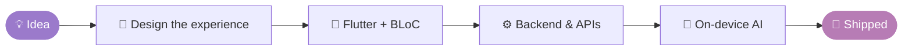

<div align="center">


<a href="https://github.com/janassaadeh">
  
</a>

<br/>

[](https://janasaadeh.com)
[](https://www.linkedin.com/in/jana-saadeh-123j/)
[](mailto:janasaadehj123@gmail.com)

</div>

---

### ✦ `class Jana extends Developer`

```dart
class Jana extends Developer {
  final role       = 'Mobile Software Engineer';
  final experience = '3 years building for real clients';
  final location   = 'Lebanon 🇱🇧  (open to remote & relocation)';

  final education = [
    "Master's in Web Development  → Lebanese University",
    'B.S. Computer Science (Honors) → Beirut Arab University',
  ];

  final superpowers = [
    'Flutter · Clean Architecture · BLoC',
    'Native Android integrations',
    'Spring Boot · ASP.NET Core · MongoDB',
  ];

  final currentlyExploring = 'On-device AI & practical machine learning 🧠';

  @override
  Widget build(BuildContext context) {
    return Scaffold(
      body: Center(
        child: Text('Building things that feel good to use ✨'),
      ),
    );
  }
}
```

---

### ✦ How I build



---

### ✦ Tech stack

<div align="center">

**📱 Mobile**


**⚙️ Backend & Databases**


**🧠 AI & Tools**


</div>

---

### ✦ Featured projects

<table>
  <tr>
    <td width="50%" valign="top">
      <h4>🌿 <a href="https://github.com/janassaadeh/kora-ai">Kora AI</a></h4>
      <p>Privacy-first wellness app with <b>on-device speech emotion recognition</b>. Your voice never leaves your phone.</p>
      <sub><code>Flutter</code> · <code>BLoC</code> · <code>TensorFlow Lite</code></sub>
    </td>
    <td width="50%" valign="top">
      <h4>⛽ <a href="https://github.com/janassaadeh/arco-energies">Arco Energies</a></h4>
      <p>Fuel station management and customer loyalty system, built for a <b>real client</b>.</p>
      <sub><code>Flutter</code> · <code>Spring Boot</code> · <code>MongoDB</code> · <code>NFC</code></sub>
    </td>
  </tr>
  <tr>
    <td width="50%" valign="top">
      <h4>🎵 <a href="https://github.com/janassaadeh/music-app-frontend">Music App: Frontend</a></h4>
      <p>Streaming app with playlists, audio playback, and artist discovery.</p>
      <sub><code>Flutter</code> · <code>Dart</code> · <code>REST APIs</code></sub>
    </td>
    <td width="50%" valign="top">
      <h4>🎶 <a href="https://github.com/janassaadeh/mymusic-app-backend">Music App: Backend</a></h4>
      <p>Music platform APIs and MVC dashboards with a layered architecture.</p>
      <sub><code>C#</code> · <code>ASP.NET Core</code> · <code>SQL Server</code></sub>
    </td>
  </tr>
</table>


<details>
<summary><b>✦ Fun facts (click to open)</b></summary>

<br/>

- 🔄 I think in widgets: most problems look like a tree to me
- 🔒 I care a lot about privacy, which is why I love on-device AI
- 🧩 I enjoy the full picture: from the UI pixel to the database row
- ☕ Hot reload is my favorite feature of all time

</details>

---

<div align="center">

### ✦ Let's connect

Always interested in meaningful software projects, new technologies, and opportunities to grow.

**[Portfolio](https://janasaadeh.com) · [LinkedIn](https://www.linkedin.com/in/jana-saadeh-123j/) · [Email](mailto:janasaadehj123@gmail.com)**

<sub>Thanks for visiting! ♡</sub>


</div>
